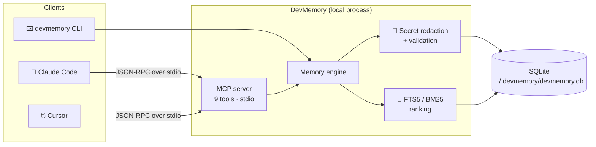
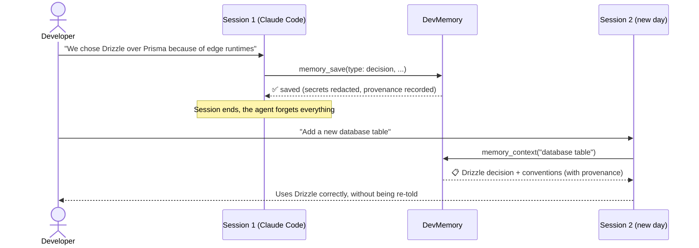

<div align="center">

# 🧠 DevMemory

### Persistent, local-first memory for AI coding agents. An MCP server and CLI for Claude Code, Cursor and other MCP clients.

**Stop re-explaining your codebase.** DevMemory remembers your project's decisions, architecture, debugging lessons and conventions across AI sessions. It runs 100% on your machine.

[](https://github.com/vasikmansuri/devmemory/actions/workflows/ci.yml)
[](https://www.npmjs.com/package/@vasikmansuri/devmemory)
[](LICENSE)
[](https://nodejs.org)
[](tsconfig.json)
[](https://modelcontextprotocol.io)
[](https://www.sqlite.org/fts5.html)
[](test)

[Quick start](#-quick-start) · [Claude Code](#-connect-claude-code) · [Cursor](#-connect-cursor) · [MCP tools](#-mcp-tools) · [CLI](#-cli-reference) · [Security](#-security--privacy) · [Docs](#-documentation)

</div>

---

## ✨ Why DevMemory?

AI coding assistants like **Claude Code** and **Cursor** forget everything when a session ends. Every new conversation, you explain the same architecture, the same "we tried X and it broke", the same team conventions.

**DevMemory gives your AI agent long-term project memory** through the [Model Context Protocol (MCP)](https://modelcontextprotocol.io):

|                              | Without DevMemory          | With DevMemory                            |
| ---------------------------- | -------------------------- | ----------------------------------------- |
| 🗂️ Project decisions         | Re-explained every session | Saved once, retrieved automatically       |
| 🐛 Debugging lessons         | Rediscovered the hard way  | Recalled when the same symptom appears    |
| 📏 Conventions & constraints | Forgotten mid-task         | Included in every relevant context bundle |
| 🔒 Privacy                   | Context pasted into chats  | Stored locally in SQLite, never uploaded  |

## 🚀 Features

- 🏠 **Local-first and private.** A single SQLite file at `~/.devmemory/`. No cloud, no account, no telemetry, no network port.
- 🔌 **MCP server.** 9 tools over stdio, verified with **Claude Code**. Works with any MCP client.
- 🗃️ **Project-scoped memory.** Each repository's knowledge is isolated, and no project can read another's.
- 🏷️ **Structured memory types:** decisions, architecture, debugging lessons, conventions, constraints, task context and facts. Each memory has tags, importance, confidence and an optional expiry.
- 🔎 **Fast, explainable search.** SQLite FTS5 full-text search with BM25 ranking, weighted by importance, confidence and recency. Every result explains its score.
- 🧾 **Provenance.** Every memory records where it came from: source, client, file, PR or commit reference, and timestamps.
- 🔐 **Secret redaction.** API keys, tokens, passwords and private keys are redacted _before_ anything is stored.
- 🛡️ **Prompt-injection aware.** Retrieved memories are wrapped as untrusted data, and instruction-like content is flagged.
- ♻️ **Safe lifecycle.** Duplicate detection, conflict surfacing, supersede chains, reversible archiving, and hard deletes that also purge the search index.
- 📦 **Import and export.** Portable JSON with validation, size limits and protection against path traversal and symlinks.
- 🧰 **Developer CLI.** 15 commands, JSON output and meaningful exit codes for automation.

## 🏗️ How it works



### Memory across sessions



## ⚡ Quick start

Requires **Node.js ≥ 22.12**.

```bash
# 1. Install
npm install -g @vasikmansuri/devmemory

# 2. Register your project
cd ~/code/my-app
devmemory init

# 3. Save knowledge
devmemory remember -t decision --title "Use Drizzle ORM" \
  -c "Drizzle over Prisma: Prisma's engine binary breaks on edge runtimes." \
  --tags db,orm -i 4 --source-ref docs/adr/0003.md

# 4. Find it again
devmemory search "which orm"
devmemory context "touching the data layer"
```

<details>
<summary><b>Install from source</b></summary>

```bash
git clone https://github.com/vasikmansuri/devmemory.git
cd devmemory
npm ci && npm run build && npm link
devmemory --version
```

</details>

## 🤖 Connect Claude Code

✅ **Verified end to end** with Claude Code 2.1.294.

```bash
claude mcp add --transport stdio devmemory -- devmemory mcp
```

Share it with your team via `.mcp.json`:

```bash
claude mcp add --scope project --transport stdio devmemory -- devmemory mcp
```

Check the connection with `claude mcp list` or `/mcp`. Then try _"Save to DevMemory: we deploy with Argo CD"_, start a **new** session, and ask _"how do we deploy?"_

> 💡 Claude Code starts the server in your working directory, and DevMemory finds the nearest registered project automatically, even from subfolders.

## 🖱️ Connect Cursor

⚠️ **Configuration follows Cursor's documented format, but has not been tested end to end yet.** Add this to `.cursor/mcp.json`:

```json
{
  "mcpServers": {
    "devmemory": {
      "type": "stdio",
      "command": "devmemory",
      "args": ["mcp", "--project", "${workspaceFolder}"]
    }
  }
}
```

## 🧩 MCP tools

| Tool             | Description                                                                             |
| ---------------- | --------------------------------------------------------------------------------------- |
| `memory_save`    | Save a memory. Reports duplicates and possible conflicts; can supersede older memories. |
| `memory_search`  | Ranked keyword search with type, tag and status filters.                                |
| `memory_get`     | Fetch one memory with links and lifecycle history.                                      |
| `memory_update`  | Edit in place; previous values are kept in history.                                     |
| `memory_forget`  | Archive (reversible) or permanently delete (`confirm: true`).                           |
| `memory_list`    | Paginated, filtered listing.                                                            |
| `memory_context` | A token-budgeted context bundle for the current task.                                   |
| `memory_link`    | Relate memories: `depends_on`, `conflicts_with`, …                                      |
| `memory_stats`   | Project statistics.                                                                     |

## ⌨️ CLI reference

| Command                                   | Purpose                                     |
| ----------------------------------------- | ------------------------------------------- |
| `devmemory init`                          | Register the current directory as a project |
| `devmemory remember`                      | Save a memory (`-c -` reads stdin)          |
| `devmemory search <query>`                | Ranked keyword search                       |
| `devmemory get <id>`                      | Full memory with provenance and history     |
| `devmemory list`                          | Browse with filters and pagination          |
| `devmemory context [query]`               | The context bundle an agent receives        |
| `devmemory update <id>`                   | Edit a memory                               |
| `devmemory forget <id>`                   | Archive, or `--hard --yes` to delete        |
| `devmemory link <a> <b>`                  | Link two memories                           |
| `devmemory stats` · `projects` · `doctor` | Statistics, project list, health checks     |
| `devmemory export` · `import`             | Portable JSON backup and restore            |
| `devmemory mcp`                           | Run the MCP server (stdio)                  |

Add `--json` to any command for machine-readable output.

**Exit codes:** `0` ok · `1` internal error · `2` validation · `3` not found · `4` project not initialized · `5` conflict · `6` database error · `7` I/O or unsafe path.

## 📊 Search quality (measured, not claimed)

These numbers come from 36 labelled queries over a 46-memory test project (`npm run eval`):

| Metric                             | All queries | Direct wording | Paraphrased |
| ---------------------------------- | ----------- | -------------- | ----------- |
| **Recall@5**                       | **0.944**   | 1.000          | 0.750       |
| **MRR**                            | **0.922**   | 1.000          | 0.650       |
| Precision@5 (max achievable 0.228) | 0.217       | 0.229          | 0.175       |

DevMemory uses keyword search, **not semantic search**, so paraphrased questions with no shared words can miss. Semantic search is on the [roadmap](docs/roadmap.md).

## 🔐 Security & privacy

- ✅ Runs locally: no telemetry, no network listener, no external API calls.
- ✅ Secrets are redacted before storage, covering AWS keys, GitHub tokens, OpenAI and Anthropic keys, JWTs, private keys and passwords.
- ✅ The database file is readable only by your user (mode `0600`).
- ✅ Projects are isolated, and all SQL is parameterized.
- ✅ Retrieved memories are treated as **untrusted data**, never as instructions.
- ⚠️ The database is **not encrypted at rest**. Use full-disk encryption for extra protection.

Read more in the [security model](docs/security-model.md) and [SECURITY.md](SECURITY.md).

## ⚙️ Configuration

| Variable                  | Default        | Purpose                                        |
| ------------------------- | -------------- | ---------------------------------------------- |
| `DEVMEMORY_HOME`          | `~/.devmemory` | Data directory                                 |
| `DEVMEMORY_PROJECT`       | current dir    | Project to use                                 |
| `DEVMEMORY_SECRET_POLICY` | `redact`       | `redact` or `reject` writes containing secrets |
| `DEVMEMORY_EXTRA_TYPES`   | —              | Extra memory types, comma-separated            |
| `DEVMEMORY_LOG_LEVEL`     | `warn`         | Log level (stderr only)                        |

## 📚 Documentation

[Architecture](docs/architecture.md) · [Memory model](docs/memory-model.md) · [Security model](docs/security-model.md) · [MCP integration](docs/mcp-integration.md) · [Troubleshooting](docs/troubleshooting.md) · [Retrieval evaluation](docs/retrieval-evaluation.md) · [Roadmap](docs/roadmap.md) · [Contributing](CONTRIBUTING.md) · [Changelog](CHANGELOG.md)

## 🛣️ Roadmap

- [x] Local MCP server, CLI, FTS5 search, secret redaction, project isolation
- [x] Verified Claude Code integration
- [ ] Optional local embeddings for semantic search
- [ ] End-to-end verified Cursor integration
- [ ] Better tokenization for Chinese and Japanese text
- [ ] Opt-in encryption at rest

## 🤝 Contributing

Contributions are welcome! Run `npm run check` (typecheck, lint, 129 tests, build) and see [CONTRIBUTING.md](CONTRIBUTING.md).

## ⚠️ Known limitations

- Keyword search only (no semantic search yet).
- Chinese and Japanese text is tokenized coarsely.
- Moving a project folder requires running `devmemory init` again.
- The Cursor integration is unverified.

## 📄 License

[MIT](LICENSE) © Vasik Mansuri

---

<div align="center">

**If DevMemory saves you from re-explaining your codebase, please ⭐ star the repo!**

<sub>Keywords: AI memory · MCP server · Model Context Protocol · Claude Code memory · Cursor MCP · AI coding assistant · persistent context · long-term memory for LLM agents · local-first · SQLite FTS5 · developer tools</sub>

</div>

## Support

If this project is useful to you, you can support my open-source work:

<a href="https://buymeacoffee.com/vasikmansuri"></a>
